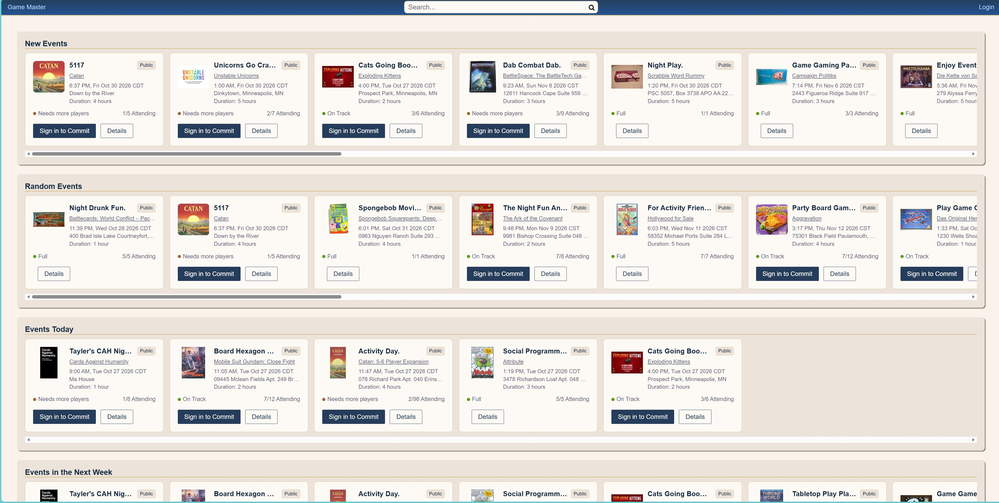
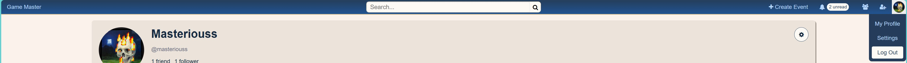
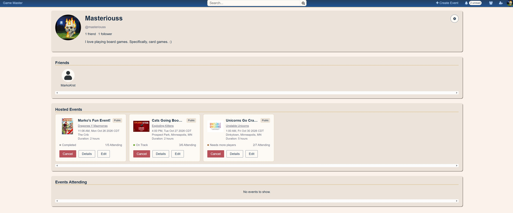
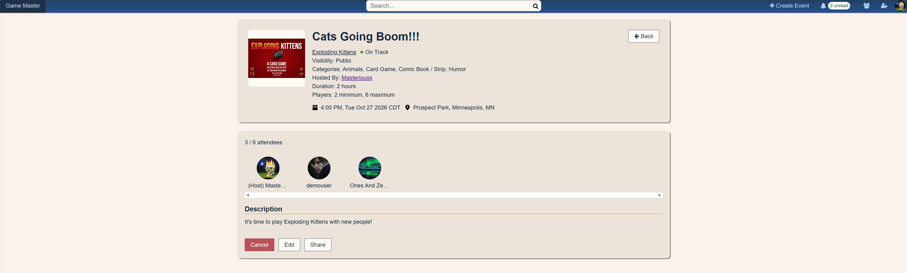
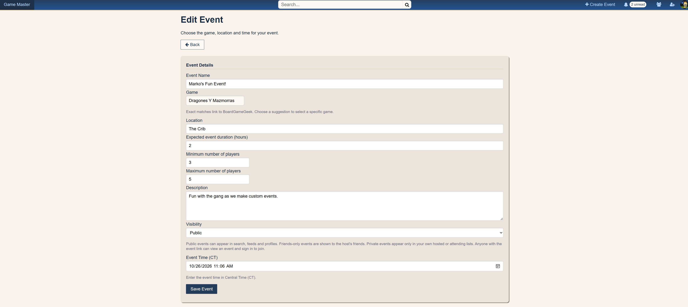
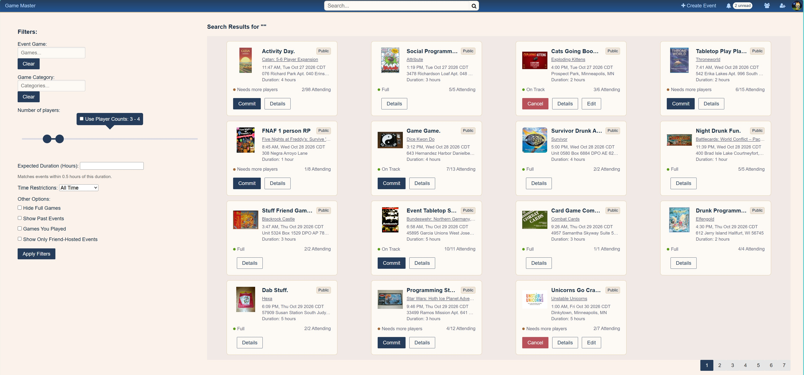
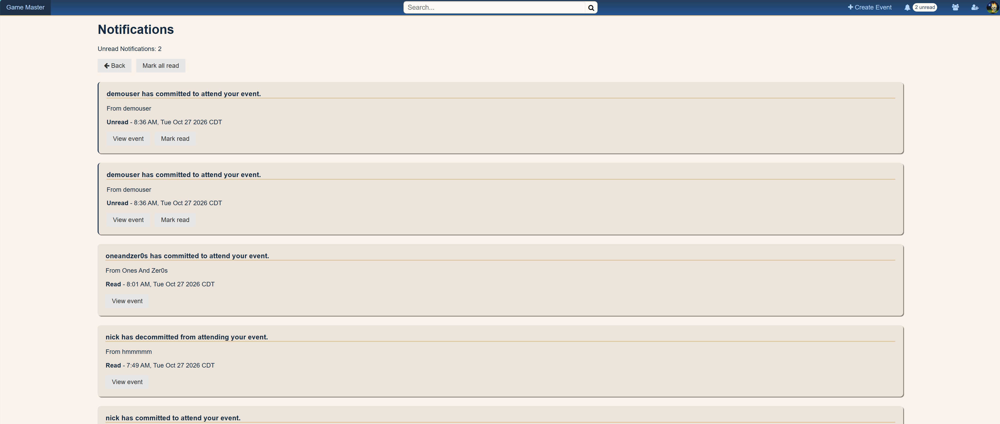
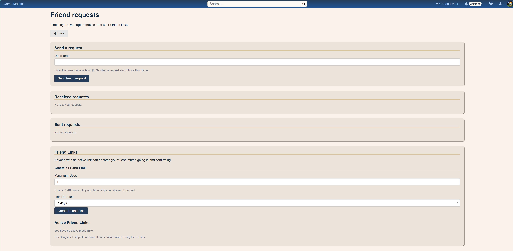

# Module 1 Group Assignment

CSCI 5117, Fall 2026, [assignment description](https://canvas.umn.edu/courses/579310/pages/project-1)

## App Info:

- Team Name: The Moneyed Monkeys 🦧
- App Name: Game Master
- App Link: <https://developing-the-interactive-web-project-1-yf9y.onrender.com/>

### Students

- Nick Hinds, hinds084@umn.edu
- Russell Shaver, shave083@umn.edu
- Marko Krstulovic, krstu002@umn.edu
- Tayler Miller, mil00154@umn.edu

## Key Features

**Describe the most challenging features you implemented
(one sentence per bullet, maximum 4 bullets):**

- BoardGameGeek Caching and API: We used the BGG API through a pre-existing Python package with a custom PostgreSQL cache backend built on requests-cache to search for games and augment events with game information.
- Searching: Search is built upon a versatile query builder that creates a custom query based on filters and parameters in order to return paginated results with high user customizability in terms of search options.
- Friends: The friends system is very fleshed out, tracking friend requests/their responses, blocking users, creating custom links for friends requests, and displaying events for friends just so users can socialize.
- Notifications: When users commit/decommit, hosts change/cancel/restore/delete events, or friend requests are sent/accepted, the affected users receive notifications saved in the same transaction as the action, with an unread count on the fixed Topbar and links to relevant pages when available.

## Testing Notes

**Is there anything special we need to know in order to effectively test your app? (optional):**

- Our testing data was generated by Faker. This is to provide an active environment with some degree of variability in the data.
- We lost a member over halfway through the project, setting us back due to scope creep.
- If the database is deleted, we can run schema.sql to quickly regenerate, and then repopulate the DB with our fake-data.py file.

## Screenshots of Site

**[Add a screenshot of each key page (around 4)](https://stackoverflow.com/questions/10189356/how-to-add-screenshot-to-readmes-in-github-repository)
along with a very brief caption:**

<strong><em>Website Screenshots + captions (click here)</em></strong>

The Landing Page lists newly created events, random ones for discovery, events today and in the next week, and all events. Logged-in users also see events from users they follow and events they are attending. Clicking an "Event Details" card opens that event's detailed view. The top bar contains the app name linking to the landing page, a search bar that opens Event Search when a query is submitted, and a login button. Logging in changes the topbar to instead of showing login, offering event creation, notifications, connections, adding friends, and a profile dropdown taking you to your profile or editing profile.

The Profile Page shows user information like username, display name, bio, friend counts, and follower counts. This page also has carousels showing friends, hosted events, and upcoming events the user is attending, subject to profile privacy settings and event visibility.

The Event Details page lists various important event details. For BGG-linked games, it contains an image of the game being played along with the name of the game and a link to its BGG page. Events can also use a custom game name without a BGG link. The details page also shows pertinent info, such as event name and description, status (Completed, Needs more players, Full, On Track, or Canceled), game categories, host, duration of the event, player count restrictions, and time/location info. Additionally, it shows a carousel with all attending members. Anyone viewing the event can copy its share link. If you are the host you have the option of editing, canceling, restoring, or deleting the event.

The Search Page offers search capabilities in the form of various filters and queries. Users can select from several filters that augment the search arguments. Typing in the top bar and searching or hitting apply filters are compatible and will pull filters for the search. Hitting the page buttons on the bottom will return a new set of paginated results. The Game filter provides suggestions from BGG searches, while the Category filter uses a predefined list of BGG categories.

The Notifications Page shows all of the notifications from user interactions like deleting/changing events and friend requests. The Add Friends Page allows users to send requests, view active incoming/outgoing requests and create friend links. These connections can later be viewed on the User Profile Page or the Connections Page (along with one-sided follows, followers, and blocked users).

## Mock-up

There are a few tools for mock-ups. Paper prototypes (low-tech, but effective and cheap), Digital picture edition software (gimp / photoshop / etc.), or dedicated tools like moqups.com (I'm calling out moqups here in particular since it seems to strike the best balance between "easy-to-use" and "wants your money" -- the free teir isn't perfect, but it should be sufficient for our needs with a little "creative layout" to get around the page-limit)

In this space please either provide images (around 4) showing your prototypes, OR, a link to an online hosted mock-up tool like moqups.com

**[Add images/photos that show your paper prototype (around 4)](https://stackoverflow.com/questions/10189356/how-to-add-screenshot-to-readmes-in-github-repository) along with a very brief caption:**

<strong><em>Mock-up images + captions (click here)</em></strong>

### Landing page

The Landing Page lists events for popular games, games the user has played, the next week, and friends' events. Clicking an "Event Details" card opens that event's detailed view. The top bar contains the app name, which links to the landing page, and a search bar that opens Event Search when a query is submitted. Guests see a "Login" button, while logged-in users see a profile icon that links to their profile.

### My events

The My Events page lists events the user hosts or attends, with a "Host New" button for creating an event. Each reusable event card shows the event name, host username, date and time, location, status, and current attendance. "Details" opens the Event View page. "RSVP" lets users register when space is available and they are not the host.

### Event view

The Event View page displays the event name, game, host, image, location, capacity, status, and description. Pending events show a proposed date range and the number of interested users. "Show Interest" opens the scheduling pop-up to collect availability, while "Finalize" lets the host choose a date and time. Scheduled events show the confirmed date and time range, attendance count, and an "RSVP" button. Users can share the event link, and the event's creator or owner can delete it.

### Event scheduling

Clicking "Show Interest" on a pending event opens the Event Scheduling pop-up. A calendar with columns from Monday through Sunday lets users select the time ranges when they are available. "Send Availability" submits their selections for the host to review during finalization.

### Event finalization

Clicking "Finalize" opens the Event Finalization page for the host. The calendar displays interested users' submitted availability together so the host can compare possible times. Below the calendar, the host selects the event date, start time, and end time. Once scheduled, the event accepts registrations through "RSVP" on the Event View page.

### Create/edit event

"Host New" on the My Events page opens the Create/Edit Event form. Users enter the event name, game, location, maximum attendance, and description. The status dropdown lets users select whether the event is pending or scheduled. Pending events require a proposed start and end date; scheduled events require a specific date and time. The host can also edit an existing event, with the form showing its current information. The bottom button creates the event or saves the changes.

### Profile page

Selecting a user from search results or an event listing opens their Profile page. It shows their username, profile picture, friend count, public friends list, games, and event history. Event cards indicate whether the user hosted or attended. When viewing another user's profile, an "Add Friend" button appears if the users are not already friends. On their own profile, users can copy and share their friend code so others can add them directly.

### Event search

Submitting a query in the top search bar opens the Event Search page. Users can search by text and filter results by game, date, location, duration, event capacity, and games played. Results are paginated and use the same "Event Details" cards as other pages. Clicking a card opens that event's detailed view.

## External Dependencies

**Document integrations with 3rd Party code or services here.
Please do not document required libraries. or libraries that are mentioned in the product requirements**

- BGG API: The BoardGameGeek API linked us with game information that was pertinent to inform users of in events. We pulled information like the game descriptions, categories, mechanics, and more from this API.
- boardgamegeek Python Package: This intermediate package offered specific functions that structured queries to the BGG API. We provided our token from the API to the package and used this as middleware to connect to the API for ease of querying.
- Cloudflare R2 and boto3: We used Cloudflare's private R2 storage through boto3's S3-compatible API to store user avatar images, keeping object keys rather than image data in our database.
- Fontawesome: Provided a library of icons to use for some buttons or links, such as search or settings.
- Faker: Used to create fake development data for our database schema so that we can populate the database to test UI and backend functionalities.
- Pillow library: Image processing library used to decode supported avatar uploads, correct orientation, resize images, and convert them to JPEG before storage.
- requests-cache: Used with our custom PostgreSQL backend to cache HTTP responses fetched from the BGG API.
- Validators library: Validation of safe URLs, such as for image uploads.
- Flask-WTF: Offers CSRF protection for the app entirely.

**If there's anything else you would like to disclose about how your project
relied on external code, expertise, or anything else, please disclose that
here:**

- Some code was pulled from online tutorials or guides (like the range slider on search). These are cited in the comments whenever very similar or from tutorials. The same goes for styling.
- The BGG API was heavily adapted due to complexity, so code similiarities might exist.
- Some SVGs used for icons were used as sample images and are attributed where necessary. These were sourced from [svgrepo.com](https://www.svgrepo.com/)
- Some AI was used to generate fake data recommendations for populating fields.
