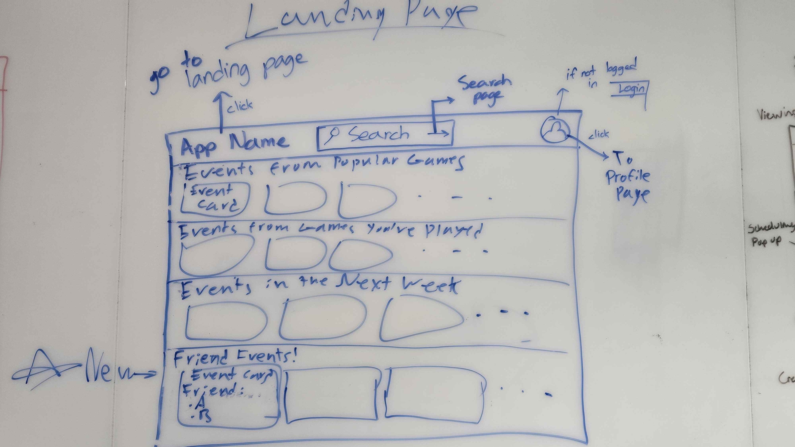
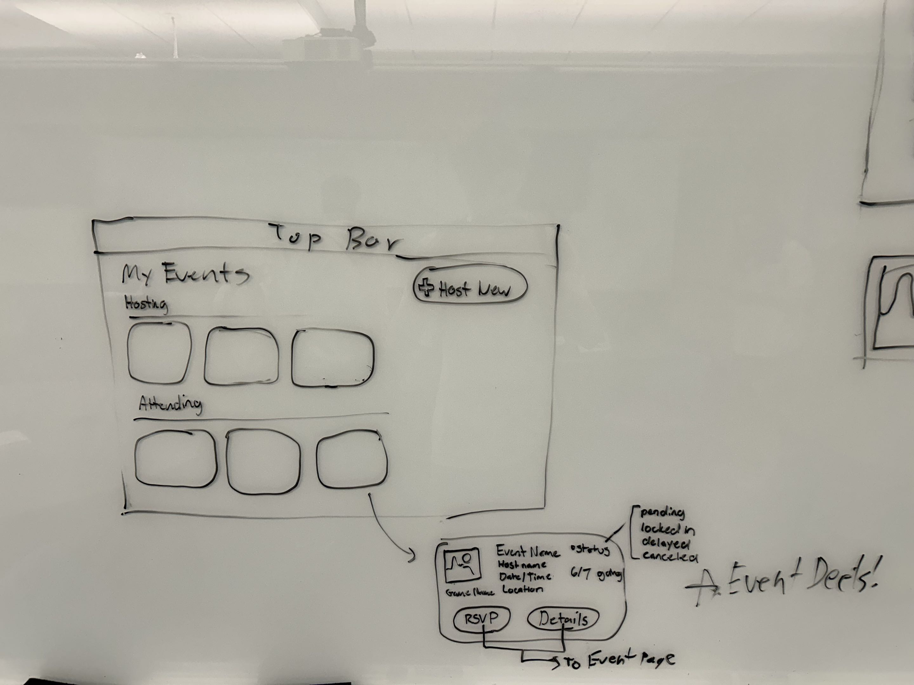
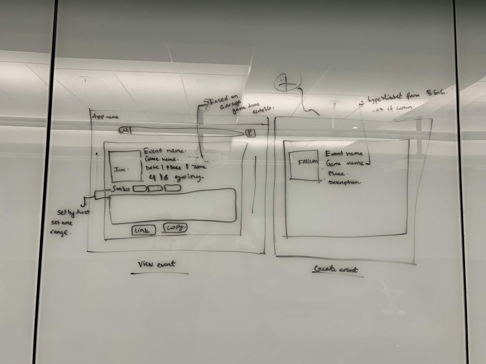
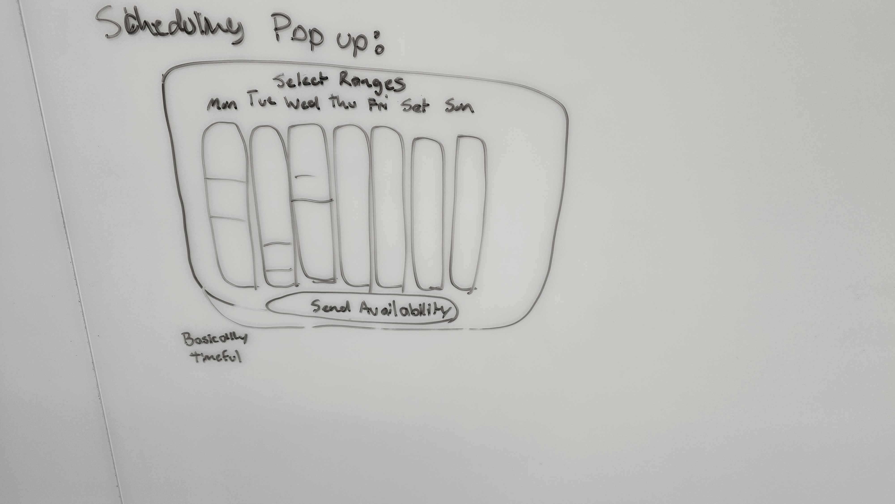
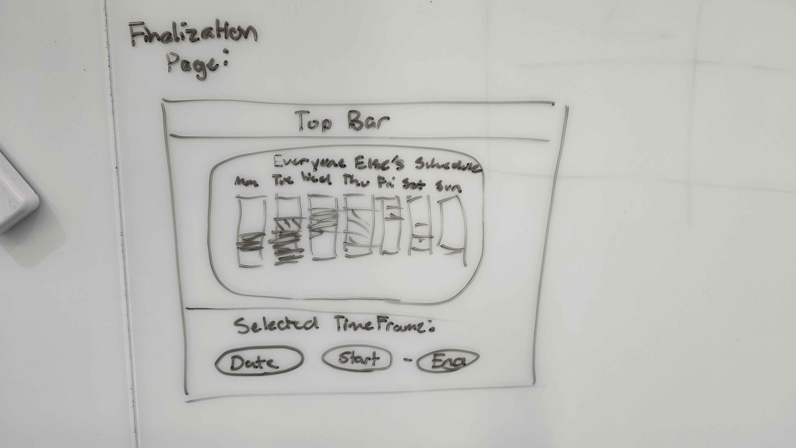
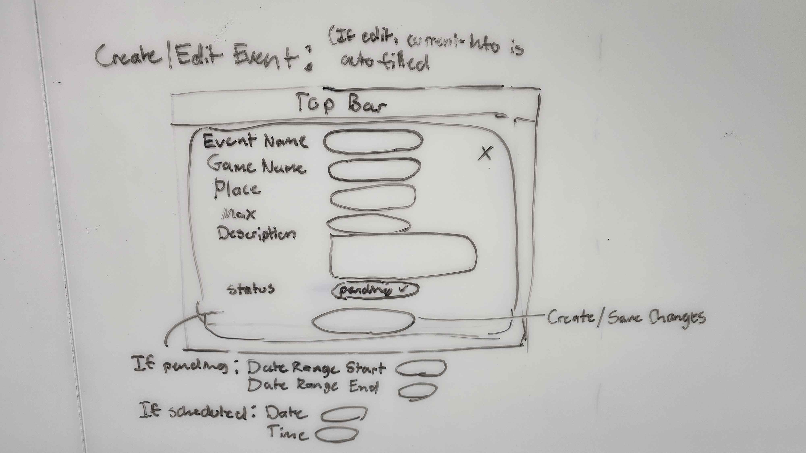
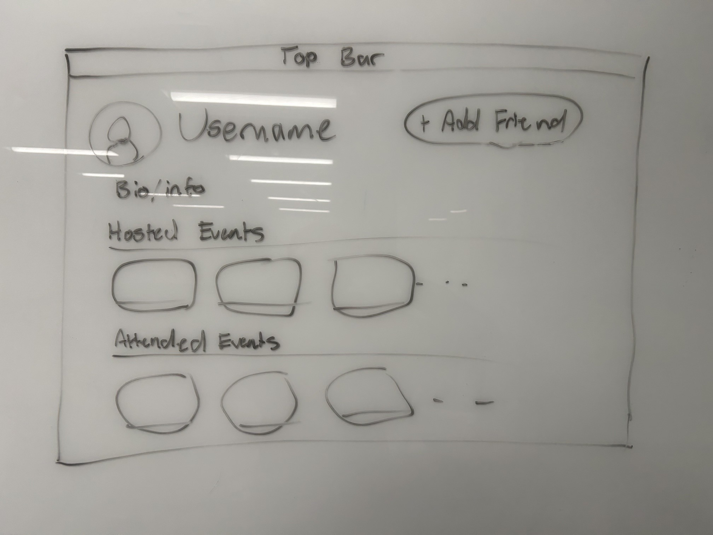
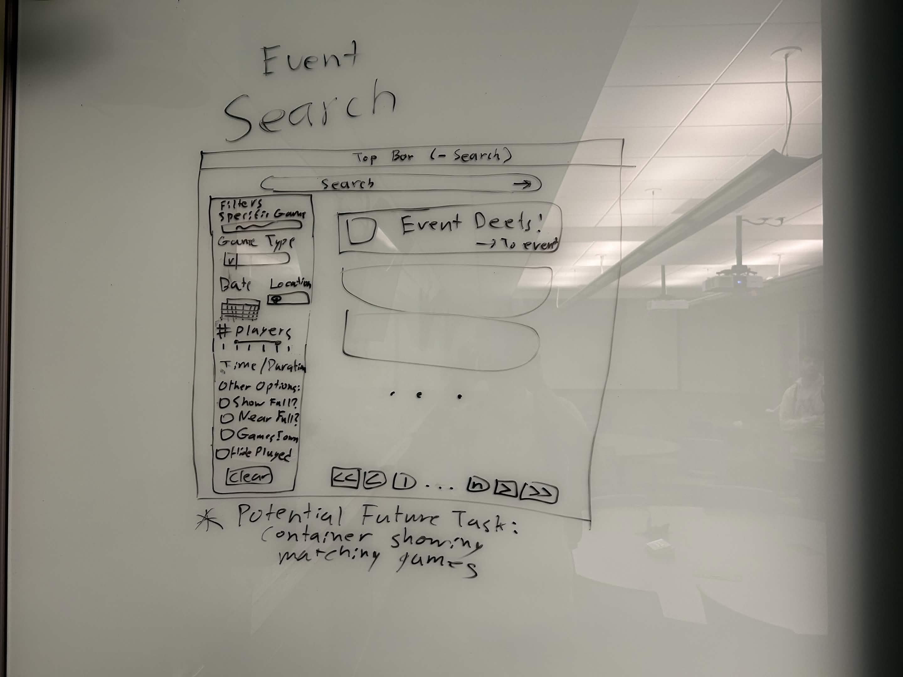

# Module 1 Group Assignment

CSCI 5117, Fall 2026, [assignment description](https://canvas.umn.edu/courses/579310/pages/project-1)

## App Info:

- Team Name: The Moneyed Monkeys 🦧
- App Name: Game Master
- App Link: <https://developing-the-interactive-web-project-1-yf9y.onrender.com/>

### Students

- Nick Hinds, hinds084@umn.edu
- Russell Shaver, shave083@umn.edu
- Marko Krstulovic, krstu002@umn.edu
- Pranshu Panda, panda068@umn.edu
- Tayler Miller, mil00154@umn.edu

## Key Features

**Describe the most challenging features you implemented
(one sentence per bullet, maximum 4 bullets):**

- ...

## Testing Notes

**Is there anything special we need to know in order to effectively test your app? (optional):**

- ...

## Screenshots of Site

**[Add a screenshot of each key page (around 4)](https://stackoverflow.com/questions/10189356/how-to-add-screenshot-to-readmes-in-github-repository)
along with a very brief caption:**

## Mock-up

There are a few tools for mock-ups. Paper prototypes (low-tech, but effective and cheap), Digital picture edition software (gimp / photoshop / etc.), or dedicated tools like moqups.com (I'm calling out moqups here in particular since it seems to strike the best balance between "easy-to-use" and "wants your money" -- the free teir isn't perfect, but it should be sufficient for our needs with a little "creative layout" to get around the page-limit)

In this space please either provide images (around 4) showing your prototypes, OR, a link to an online hosted mock-up tool like moqups.com

**[Add images/photos that show your paper prototype (around 4)](https://stackoverflow.com/questions/10189356/how-to-add-screenshot-to-readmes-in-github-repository) along with a very brief caption:**

<strong><em>Mock-up images + captions (click here)</em></strong>

### Landing page

The Landing Page lists events for popular games, games the user has played, the next week, and friends' events. Clicking an "Event Details" card opens that event's detailed view. The top bar contains the app name, which links to the landing page, and a search bar that opens Event Search when a query is submitted. Guests see a "Login" button, while logged-in users see a profile icon that links to their profile.

### My events

The My Events page lists events the user hosts or attends, with a "Host New" button for creating an event. Each reusable event card shows the event name, host username, date and time, location, status, and current attendance. "Details" opens the Event View page. "RSVP" lets users register when space is available and they are not the host.

### Event view

The Event View page displays the event name, game, host, image, location, capacity, status, and description. Pending events show a proposed date range and the number of interested users. "Show Interest" opens the scheduling pop-up to collect availability, while "Finalize" lets the host choose a date and time. Scheduled events show the confirmed date and time range, attendance count, and an "RSVP" button. Users can share the event link, and the event's creator or owner can delete it.

### Event scheduling

Clicking "Show Interest" on a pending event opens the Event Scheduling pop-up. A calendar with columns from Monday through Sunday lets users select the time ranges when they are available. "Send Availability" submits their selections for the host to review during finalization.

### Event finalization

Clicking "Finalize" opens the Event Finalization page for the host. The calendar displays interested users' submitted availability together so the host can compare possible times. Below the calendar, the host selects the event date, start time, and end time. Once scheduled, the event accepts registrations through "RSVP" on the Event View page.

### Create/edit event

"Host New" on the My Events page opens the Create/Edit Event form. Users enter the event name, game, location, maximum attendance, and description. The status dropdown lets users select whether the event is pending or scheduled. Pending events require a proposed start and end date; scheduled events require a specific date and time. The host can also edit an existing event, with the form showing its current information. The bottom button creates the event or saves the changes.

### Profile page

Selecting a user from search results or an event listing opens their Profile page. It shows their username, profile picture, friend count, public friends list, games, and event history. Event cards indicate whether the user hosted or attended. When viewing another user's profile, an "Add Friend" button appears if the users are not already friends. On their own profile, users can copy and share their friend code so others can add them directly.

### Event search

Submitting a query in the top search bar opens the Event Search page. Users can search by text and filter results by game, date, location, duration, event capacity, and games played. Results are paginated and use the same "Event Details" cards as other pages. Clicking a card opens that event's detailed view.

## External Dependencies

**Document integrations with 3rd Party code or services here.
Please do not document required libraries. or libraries that are mentioned in the product requirements**

- Library or service name: description of use
- ...

**If there's anything else you would like to disclose about how your project
relied on external code, expertise, or anything else, please disclose that
here:**

...
